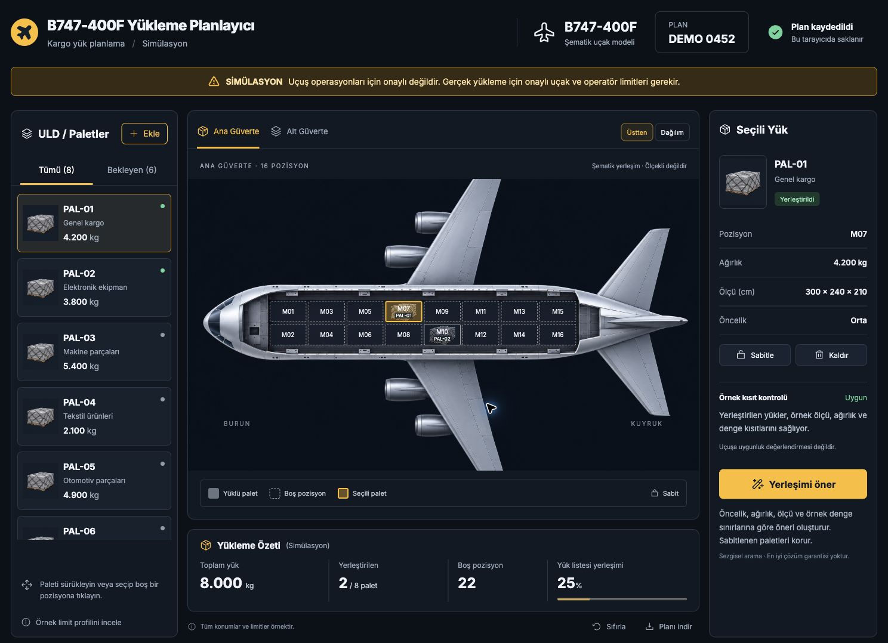

# Boeing 747-400F Cargo Load Planner

Türkçe, görsel kargo yerleşim simülasyonu. Koyu arayüz, sarı vurgular ve sürükle bırak palet yerleştirme içerir.

**SİMÜLASYON — Uçuş operasyonları için onaylı değildir. Gerçek yükleme için onaylı uçak ve operatör limitleri gerekir.** Uçak çizimi, pozisyonlar ve limitler örnektir; teknik yükleme planı olarak kullanılamaz.

[Çalışan Sites uygulaması](https://cargo-planner-747-taha.jonahshalvadze.chatgpt.site) — mevcut paylaşım izinlerine göre ChatGPT ile giriş gerektirir.



## Özellikler

- Palet ekleme, sürükleyerek veya tıklayarak pozisyona yerleştirme.
- Ana ve alt güverte görünümü; boyuna yük dağılımı grafiği.
- Pozisyon ağırlığı, ölçü, toplam yük ve bölge yükü kontrolleri.
- Örnek boyuna denge ve sol–sağ yük farkı kontrolleri.
- Palet sabitleme; sabitlenen yükleri koruyan otomatik öneri.
- Mevcut ve önerilen planı karşılaştırma; yerleşemeyen paletlerin nedenlerini gösterme.
- Tarayıcıda yerel kayıt, JSON indirme ve örnek planı sıfırlama.
- Küçük ekranlar için dokunulabilir pozisyon listesi.

Öneri motoru sınırlı genişlikte sezgisel arama kullanır; matematiksel olarak en iyi çözüm garantisi vermez. Uçak boş ağırlığı, yakıt, gerçek ağırlık merkezi zarfı, zemin/bağlama limitleri, tehlikeli maddeler ve operasyonel yükleme sırası modellenmez.

## Yerel çalıştırma

Node.js 22 ve npm gerekir.

```sh
npm ci
npm run dev
```

Terminalde gösterilen yerel adresi açın. Veriler aynı tarayıcının `localStorage` alanında saklanır; ekip üyeleri arasında canlı senkronizasyon yoktur.

## Derleme ve kontroller

```sh
npm run build
node --test tests/engine.test.mjs
npm run test:sites
```

Derleme `dist/client` altında istemci dosyaları, `dist/server/index.js` altında Sites worker dosyası üretir.

## Kaynak yapısı

| Yol | İçerik |
| --- | --- |
| `src/App.jsx` | Arayüz ve etkileşimler |
| `src/engine.mjs` | Örnek profil, yerleşim kontrolleri ve öneri motoru |
| `src/styles.css` | Görsel tasarım ve uyarlanabilir düzen |
| `public/assets/` | Uçak ve palet görselleri |
| `tests/` | Öneri motoru ve Sites worker kontrolleri |
| `worker/` | Sites sunucu giriş noktası |
| `.openai/hosting.json` | Mevcut Sites projesinin kimliği ve yapılandırması |

## Birlikte geliştirme

Değişiklikleri ayrı dallarda hazırlayıp pull request açın. Birleştirmeden önce yukarıdaki derleme ve kontrolleri çalıştırın. Gerçek uçak verisi eklenecekse kaynağı, sürümü ve operatör onayı ayrıca belgelenmelidir.

GitHub'a yapılan değişiklikler Sites uygulamasını otomatik yayımlamaz. Bu depo ilk yayınlanan prototipin kaynak kopyasıdır; güncellenen sürümün Sites'a aktarımı ayrı bir adımdır. `.openai/hosting.json` mevcut projeyi işaret eder; yeni, bağımsız bir Sites uygulaması oluşturulacaksa yeni proje kimliği kullanılmalıdır.

## GitHub Pages

[GitHub Pages uygulaması](https://shalvadze-bot.github.io/boeing-747-cargo-planner/)

`main` dalına gönderilen değişiklikler `.github/workflows/pages.yml` ile test edilir, derlenir ve yalnızca `dist/client` çıktısı GitHub Pages’e yayımlanır. Depoda Settings → Pages → Source seçeneği **GitHub Actions** olmalıdır. Kaynak `index.html` dosyasını doğrudan yayımlamayın; tarayıcı JSX geliştirme dosyalarını çalıştıramaz.

Pages derlemesini yerelde kontrol etmek için:

```sh
VITE_BASE_PATH=/boeing-747-cargo-planner/ npm run build
node --test tests/engine.test.mjs tests/sites-worker.test.mjs tests/pages-build.test.mjs
```

Varsayılan `npm run build`, mevcut Sites uygulaması için kök (`/`) yolunu korur. GitHub Pages yayını Sites uygulamasını değiştirmez.

## Döndürülebilir 3D uçak görünümü

Uçak çalışma alanı açılışta `3D uçak` görünümünü gösterir. Sürükleyerek uçağın çevresinde dönebilir, yakınlaştırabilir ve kamera açılarını değiştirebilirsiniz. `Üstten` ve `Dağılım` görünümleri ile PMC çalışma alanı korunur; uçak görünümleri aynı yük listesini, yerleşimi ve sabitleme kontrollerini kullanır.

Uçak geometrisi ilk Sites uygulamasının 2. sürümündeki `ThreeCargoDigitalTwin.tsx` dosyasından geri alınmıştır (kaynak commit: `ff2cbef8ffb36e9041f242c6f10af0f1eb1f5b3d`). GitHub kaynak kopyasında daha eski `App.jsx` girişi bulunduğu için bu 3D görünüm eksikti. Yalnızca görsel model ve kamera davranışları taşınmıştır; eski uygulamanın ayrı yük listesi, örnek uçak CG hesabı ve farklı limitleri mevcut plana uygulanmaz.

3D model ve pozisyonlar şematiktir, ölçekli teknik model veya operasyon onayı değildir. WebGL kullanılamıyorsa `Üstten` görünümü ile planlamaya devam edilebilir. Tarayıcıdaki mevcut uçak ve PMC kayıtları değiştirilmez.

## PMC 3D paletleme

`PMC · 3D paletleme` sekmesi mevcut uçak yerleşiminden bağımsız hesaplanır. Uçak planı yalnızca **Uçak paletlerine ekle** işlemini onayladığınızda yeni kopyalarla genişletilir.

- Fiziksel taban: 96 × 125 inç = 243,84 × 317,5 cm. Her kenardaki 8,5 cm boşluk çıkarıldığında net taban **226,84 × 300,5 cm** olur.
- ZX-11 geometrisi kullanıcının sağladığı çizimden alınmıştır: 96 inç tepe, 39,5 inç düz üst bölüm, 56,5 inç eğim yatay açıklığı ve 41 inç alçak kenar. Kontur fiziksel plaka eksenindedir; iki yön için aynalanabilir. Bu veri sertifikalı Boeing veya operatör profili değildir.
- Her yük satırında parça adı, uzunluk, genişlik, yükseklik, adet, isteğe bağlı birim ağırlık ve ayrı renk bulunur. `90° çevir` yalnızca tabandaki dönüşe izin verir; yük devrilmez. `Üstüne yük` o parçanın başka bir parçaya destek olmasına izin verir; ezilme dayanımı hesabı değildir.
- Sezgisel arama üç farklı sıralamayı karşılaştırır. Normal istifler aynı yükseklikteki bir veya birden fazla istiflenebilir parçanın ortak üst yüzeyinde tam taban desteği ister. Yüzeyler arasındaki boşluklar, yükseklik farkları ve istif izni olmayan parçalar destek sayılmaz. Bu geometrik kontrol ezilme dayanımını veya yük taşıma kapasitesini doğrulamaz. JSON çıktısındaki `supportIds` tüm temas eden destekleri gösterir; `supportId` yalnızca tek destek olduğunda doludur. En iyi yerleşim veya minimum palet sayısı garanti edilmez.
- Çoklu palet görünümü, tek palet yakın görünümü, kamera dönüşü/yakınlaştırma, katman kesiti, parça seçimi, koordinatlar ve JSON dışa aktarma vardır. Girdi değişince önceki plan işaretlenir, yeniden hesaplanmadan dışa aktarılamaz.
- Geometrik doluluk: net taban üzerindeki ZX-11 zarfına oran. Kenar boşluklarındaki taşma hacmi doluluk payına eklenmez. Ağırlık yalnızca bilgilendirme verisidir; ağırlık, CG, taban basıncı ve bağlama limitleri uygulanmaz.
- Üst taşma varsayılan kapalıdır. Azami taşma ve asgari başlangıç yüksekliği kullanıcı tarafından verilmelidir. Yalnızca sonraki boyuna palete taşma denenir, komşu palet hacmi ayrılır ve çakışmalar engellenir. Kısmi destek, sehim, devrilme, ağırlık aktarımı veya operasyon izni doğrulanmaz. Taşan her parça inceleme gerektirir.
- Etkileşimli sürüm bir hesapta 100 yük satırı / 200 parça destekler; arayüzde en fazla 20 palet seçilir.

### Fotoğraf / PDF aktarımı

Belge tarayıcıda işlenir; dosya veya çıkarılan metin sunucuya ya da bir AI hizmetine gönderilmez. PDF metni PDF.js ile, görsel metni Tesseract.js ile okunur. Tarama veya karışık PDF'lerde `PDF sayfalarını OCR ile oku` seçeneği kullanılabilir. Çalışan dosyalar ve İngilizce/rakam odaklı OCR verisi uygulamayla aynı kaynaktan yüklenir; ilk OCR okuması ek indirme gerektirir.

Desteklenenler: PDF (en fazla 8 sayfa), PNG, JPEG, WebP; 15 MB dosya ve 12 MP görsel sınırı. Otomatik çıkarım `120 × 80 × 60 cm`, `qty: 3` / `3 adet` gibi açık ölçü üçlüleri ve adet etiketlerini tanır. Ayrı tablo sütunları, el yazısı ve düşük kaliteli görüntüler doğru okunmayabilir. Ham metin ve aday satırlar düzenlenebilir. Her satırda ölçü sırası, birim, adet ve değerler kontrol edilmeden, kullanıcı inceleme kutusunu işaretleyip `Listeye ekle` demeden yük listesine aktarılmaz. Eksik satırlar için elle aday eklenebilir. İçe alınan yüklerde ağırlık bilinmiyor, dönüş ve istif izni kapalı başlar.

OCR sonucunun eksiksiz veya doğru olduğu garanti edilmez. Gerçek yükleme öncesinde kaynak belge ve onaylı uçak/operatör verileriyle ayrıca doğrulayın.

### Kontroller

```sh
npm ci
VITE_BASE_PATH=/boeing-747-cargo-planner/ npm run build
node --test tests/*.test.mjs
```

`npm run dev` ve `npm run build`, OCR varlıklarını bağımlılıklardan `public/ocr` altına hazırlar; bu üretilen klasör Git'e eklenmez. PR doğrulama iş akışı yalnızca derleme ve test yapar, yayın yapmaz. `main` iş akışı tüm testleri geçtikten sonra GitHub Pages'e yayın yapar.

### PMC paletlerini uçakta görüntüleme

Güncel PMC hesaplamasının altında **Uçak paletlerine ekle** düğmesini kullanın. Her palet için palet darası dahil brüt ağırlığı girip **Ekle ve uçakta göster** seçin. Bilinen parça ağırlıkları yalnızca alt sınırdır; eksik ağırlıklar sıfır kabul edilmez.

Hesaplanan kutu ölçüleri, konumları ve renkleri ULD listesine bir kopya olarak eklenir ve 3D uçakta gösterilir. Mevcut paletler, yerleşimler ve kilitler korunur. Yalnızca mevcut örnek ölçü/ağırlık kontrollerini geçen boş pozisyonlar kullanılır; yer bulunamayan paletler bekler. Aynı hesaplama ikinci kez eklenmez. Sonraki PMC düzenlemeleri aktarılmış kopyaları değiştirmez. Komşu palete üst taşma olan hesaplamalar, birbirinden bağımsız uçak pozisyonlarına taşınamaz; önce taşmayı kapatıp yeniden hesaplayın.

Bu aktarım operasyon onayı değildir. Kutuların en-boy-yükseklik oranları korunur ancak uçak pozisyonlarının şematik ölçeğine küçültülür. Ağırlık merkezi, zemin, bağlama veya gerçek uçak konturu uygunluğu doğrulanmaz. Telefonlarda ULD listesini parmağınızla kaydırın; bir paleti seçip boş pozisyona dokunarak yerleştirin. Fareyle sürükleme korunur.


### Yalnız seçili PMC için görsel önizleme

Uçak yük listesinde bir PMC paletini seçip **Yalnız bu PMC’yi görsel önizle** düğmesine basın. Ayrı önizleme penceresi yalnızca seçili paletin kutularını 3D uçakta gösterir; diğer yükler silinmez. Mevcut ana güverte pozisyonu varsa görsel referans olarak kullanılır, yoksa M07 yalnızca şematik referanstır. Bu referans kaydedilmiş plana atanmaz.

Önizleme ağırlık, ölçü, denge veya operasyonel uygunluk kontrolü yapmaz. Kayıtlı ağırlık açıkça gösterilir ama değiştirilmez ve doğru kabul edilmez. Önizleme sırasında pozisyon seçme/yerleştirme kapalıdır. Kargo listesi, yerleşimler, sabitlemeler, özet, indirme çıktısı ve her iki tarayıcı kaydı korunur. Pencereyi kapatınca normal kontroller aynen devam eder; örnek ağırlık limitini aşan palet hâlâ normal yerleşimde engellenir. Bu görünüm yükleme veya uçuş onayı değildir.

### Tek PMC üzerinde uzun yük — test önizlemesi

Yeni açık seçim, bir parçayı bir fiziksel PMC üzerinde ortalı veya ön/arka/sol/sağ kenara hizalı gösterir. İzin verilen 90° dönüşler ayrıca karşılaştırılır. Hizalanan, taşmayan kenarda 8,5 cm taban boşluğu korunur. Net kullanılabilir sınır aşımı fiziksel kenar taşmasından ayrı gösterilir. Fiziksel kenardan taşma cm ve inç olarak 3D üzerinde ölçülür; 8,5 cm taban boşluğu yükseklikten çıkarılmaz.

Bu modda her parça bağımsız, istifsiz bir test senaryosudur. S(x,y) alanları eşit fiziksel PMC adımlı şematik hücrelerdir, gerçek uçak pozisyonları değildir. Taşmanın kapladığı komşu hücreler BOŞ BIRAK olarak işaretlenir; yeni plaka veya yinelenen ağırlık oluşturulmaz. Birden fazla parçanın pozisyon toplamı bağımsız senaryoların toplamıdır, ortak uçak yük planı değildir. Bu mod için uçak planına aktarım hem arayüzde hem aktarım fonksiyonunda kapalıdır.

Seçim yalnızca şematik pozisyon sayısını azaltır, ağırlık merkezini optimize etmez. Kapı geçişi, manevra, gerçek konturlar, destek/sehim, CG, yük limitleri ve bağlama doğrulanana kadar sonuç teknik doğrulama bekliyor durumundadır. Bu güncelleme operasyon onayı değildir.

Ön/arka seçimleri, 317,5 cm uzun kenarları ifade eder: ön X=0, arka X=243,84 cm. Sol/sağ seçimleri Y=0 / Y=317,5 cm kısa kenarlarıdır. Seçim değiştiğinde aynı 3D görünüm otomatik yeniden hesaplanır. Örneğin döndürülmeyen 400 × 88 × 166 cm parçada ön hizalama X=8,5 cm, arka hizalama X=147,34 cm olur; her iki seçenekte hizalanan kenarın 8,5 cm boşluğu korunur.

3D palet planında **Ölçüler** kutusu yalnızca sahnedeki ölçü çizgilerini, okları ve cm/inç açıklamalarını açar/kapatır (taşma ölçüleri dahil). Kontur, kargo etiketleri, yerleşim hesabı ve güvenlik notları değişmez. Varsayılan olarak açıktır.

**Yüksek kenara hizala**, güncel uzun-yük test sonucunu konturun yüksek kenarına 8,5 cm içeriden hizalar. Mevcut boyuna konum, tek/çift taraflı boyuna taşma ve seçilmiş dönüş korunur. Kontur aynalanınca yüksek kenar karşı tarafa geçer; kamera dönüşü hesaplamayı değiştirmez. Ölçü/yön değişirse eski hizalama kullanılmaz ve yeniden uygulanması istenir. Başka yerleşim seçmek yüksek-kenar hizalamasını kaldırır. 96 inçlik düşey ölçü artık “Yüksek kenar” olarak adlandırılır. Bu test hâlâ operasyon onayı değildir.
